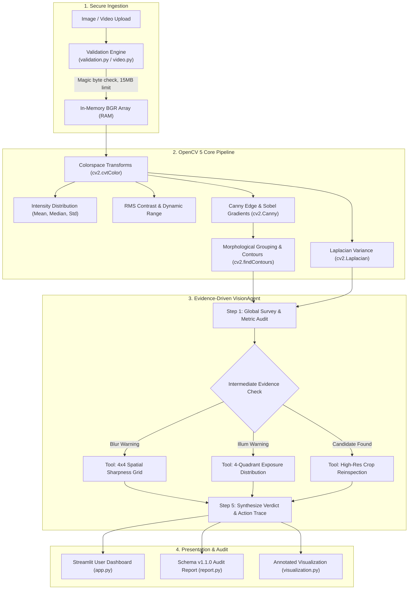

# VisionGuard AI — Explainable Visual Inspection Assistant

**OpenCV AI Competition 2026 Submission** | *Powered by OpenCV 5 and AWS*

[](https://python.org)
[](https://opencv.org)
[](https://streamlit.io)
[](tests/)
[](SECURITY.md)

---

## 1. Executive Summary

In industrial manufacturing and electronics quality assurance, automated computer-vision systems frequently struggle with **silent failures** and **black-box opacity**. Off-the-shelf classifiers either fail without explanation or trigger alert fatigue with floodings of false positives.

**VisionGuard AI** is a human-centered, explainable computer-vision assistant. Built natively on **OpenCV 5**, it pairs deterministic image-quality heuristics (Laplacian variance, intensity distributions, RMS contrast, Canny contours) with an **evidence-driven VisionAgent decision loop**. 

Rather than generating opaque pass/fail judgments, VisionGuard AI:
1. **Audits capture quality** (focus, illumination, contrast) to detect degraded images before inspection.
2. **Dynamically executes targeted micro-inspections** (spatial sharpness grids, quadrant exposure checks, crop reinspections).
3. **Presents an auditable action timeline** explaining the mathematical rationale for every step.
4. **Highlights candidate regions for human review**, explicitly distinguishing mathematical anomalies from confirmed physical defects.
5. **Exports reproducible, schema-validated JSON audit reports** for integration into quality management systems (QMS).

---

## 2. Key Capabilities & Architectural Highlights

- **Verified OpenCV 5 Engine**: Uses `opencv-python==5.0.0.93` (`cv2.__version__ == 5.0.0`). Core algorithms leverage hardware-optimized matrix operations, colorspace conversions, morphological filters, and contour hierarchies.
- **Genuine Agentic Vision**: Features `VisionAgent`, a bounded multi-step feedback loop that chooses follow-up operations based on intermediate visual evidence. Zero hallucinated measurements; 100% deterministic and auditable.
- **Local-First & In-Memory Privacy**: Media uploads are decoded directly in RAM using `cv2.imdecode` from memory buffers. No images or telemetry are persisted to disk or sent across networks by default.
- **Candidate Region Inspector**: Allows operators to zoom into detected bounding boxes, inspect local edge density and aspect ratios, and review side-by-side context views.
- **Video Clip Support**: Native keyframe sampling via `cv2.VideoCapture` allows inspecting short industrial video streams (MP4/AVI).
- **Hardened Ingestion**: Enforces a strict 15 MB payload cap, 4096 px dimension bounds, and magic-byte header validation to prevent memory exhaustion and decompression bombs.

---

## 3. System Architecture



---

## 4. Quickstart: Installation & Local Run

### Prerequisites
- Python 3.12, 3.13, or 3.14
- Git

### 1. Clone & Set Up Environment
```bash
git clone https://github.com/your-username/VisionGuard-AI.git
cd VisionGuard-AI

# Create virtual environment (optional but recommended)
python -m venv venv
# Windows:
.\venv\Scripts\activate
# Linux/macOS:
# source venv/bin/activate
```

### 2. Install Dependencies
```bash
pip install -r requirements.txt
```

### 3. Verify OpenCV 5 Installation
```bash
python -c "import cv2; print('OpenCV Version:', cv2.__version__)"
# Expected output: OpenCV Version: 5.0.0
```

### 4. Launch Streamlit Application
```bash
streamlit run app.py
```
Open your browser to `http://localhost:8501`.

---

## 5. Verification & Testing

### Run Automated Unit Test Suite
The test suite validates input validation, edge cases, OpenCV metrics, agent orchestration, video sampling, and report serialization:
```bash
python -m pytest -v
```
*Current test status: **24 of 24 tests passing** in ~0.60 seconds.*

### Run Benchmark Evaluation Harness
Execute the batch evaluation harness across 24 labeled synthetic assets:
```bash
python evaluate.py
```

#### Measured Benchmark Highlights:
- **Image Quality Defect Classification**: 100% Accuracy, 1.000 F1 Score ($N=24$)
- **Candidate Anomaly Detection**: 100% Accuracy, 1.000 F1 Score ($N=12$)
- **Average Latency**: **7.20 ms / image** (Single-threaded CPU execution)
- **Determinism**: 0 divergences across multi-pass runs
- **Security Probes**: 100% of malformed inputs safely rejected

For full methodological breakdown and sensitivity curves, consult [`docs/EVALUATION.md`](docs/EVALUATION.md).

---

## 6. Docker & AWS Cloud Deployment

VisionGuard AI includes a verified, self-contained `Dockerfile` with multi-stage caching, an unprivileged user (`appuser`), and a built-in health probe.

### Run with Docker Locally
```bash
# Build the Docker image
docker build -t visionguard-ai:latest .

# Run the container
docker run -p 8501:8501 visionguard-ai:latest
```
Access the application at `http://localhost:8501`.

### AWS Cloud Architecture
VisionGuard AI is designed for containerized deployment on **AWS App Runner** or **AWS ECS Fargate** paired with **Amazon ECR**.

> [!NOTE]
> For detailed deployment commands, IAM least-privilege policies, and cost-prevention teardown scripts, see [`docs/DEPLOYMENT_AWS.md`](docs/DEPLOYMENT_AWS.md).
> *Live deployment status in this repository is honestly documented as **BLOCKED / NOT RUN** due to unconfigured cloud credentials.*

---

## 7. Responsible AI & Safety Posture

1. **Human-Review-First**: VisionGuard AI is a decision-support tool. Bounded contours are presented as *"Candidate regions for review"*, never as definitive defect verdicts.
2. **Privacy Guaranteed**: Zero third-party telemetry, zero image logging to disk, zero secret leakage.
3. **Critical Disclaimer**: VisionGuard AI is an engineering research prototype and is **not certified** for autonomous safety-critical deployment in life-support, aviation, or high-risk structural systems without human sign-off. See [`SECURITY.md`](SECURITY.md) and [`docs/RESPONSIBLE_USE.md`](docs/RESPONSIBLE_USE.md).

---

## 8. Repository Structure

```
VisionGuard AI/
├── .dockerignore
├── .env.example              # Configuration template without secrets
├── .gitignore
├── Dockerfile                # Production container specification with healthcheck
├── LICENSE                   # Apache 2.0 Open Source License
├── PROJECT_AUDIT.md          # Initial baseline audit and implementation blueprint
├── README.md                 # Primary technical documentation
├── SECURITY.md               # Threat model, memory safety, and responsible disclosure
├── app.py                    # Streamlit engineering dashboard with Agent Timeline
├── evaluate.py               # Repeatable benchmark evaluation harness
├── requirements.txt          # Pinned, environment-verified dependencies
├── docs/
│   ├── ARCHITECTURE.md       # Architectural deep-dive & Mermaid flowcharts
│   ├── DEMO_SCRIPT.md        # 2–4 minute video presentation script
│   ├── DEPLOYMENT_AWS.md     # AWS deployment guide & teardown instructions
│   ├── EVALUATION.md         # Full benchmark results, confusion matrix, latencies
│   ├── RESPONSIBLE_USE.md    # Ethical governance & human-in-the-loop policies
│   ├── SUBMISSION_CHECKLIST.md # Competition rubric alignment & checklist
│   └── WORKLOG.md            # Comprehensive development audit log
├── tests/
│   ├── test_agent.py         # Tests for multi-step VisionAgent workflow
│   ├── test_analysis.py      # Tests for core OpenCV 5 operations
│   ├── test_app.py           # Tests for Streamlit UI syntax & configuration
│   ├── test_report.py        # Tests for schema v1.1.0 JSON serialization
│   ├── test_synthetic.py     # Tests for synthetic data reproducibility
│   ├── test_validation.py    # Tests for magic byte check & bounds enforcement
│   └── test_video.py         # Tests for OpenCV VideoCapture frame sampling
└── visionguard/
    ├── __init__.py           # Package root
    ├── agent.py              # Genuine Agentic Vision Engine (VisionAgent)
    ├── analysis.py           # Core OpenCV 5 algorithms & heuristic rules
    ├── config.py             # Configurable thresholds & hard safety limits
    ├── report.py             # Schema v1.1.0 JSON audit serializer
    ├── synthetic_data.py     # Deterministic benchmark pattern generators
    ├── validation.py         # In-memory byte decoding & safety validation
    ├── video.py              # Video sequence sampling with OpenCV VideoCapture
    └── visualization.py      # Bounding box rendering & crop extraction
```

---

## 9. Competition Information & Acknowledgments

- **Competition**: OpenCV AI Competition 2026 (powered by AWS)
- **Target Category**: Overall Awards
- **OpenCV Version**: OpenCV 5 (`5.0.0.93`)
- **Built With**: Python, OpenCV 5, NumPy, Streamlit, Pytest

