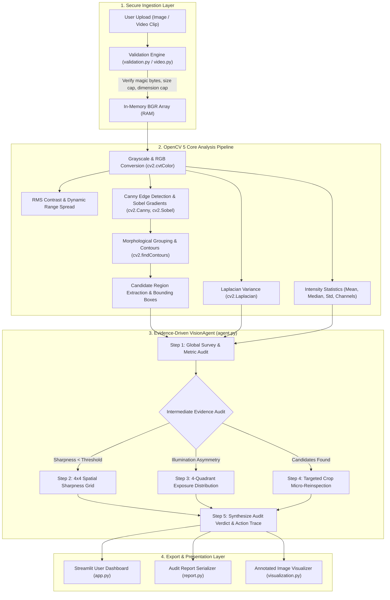

# VisionGuard AI — System Architecture & Data Flow

VisionGuard AI is designed with a layered, modular architecture that decouples input validation, computer vision processing, agent orchestration, report serialization, and presentation.

## 1. Architectural Component Overview

## 2. Component Breakdown

### 1. Ingestion & Validation (`visionguard/validation.py`, `visionguard/video.py`)
- **Isolation**: Media bytes are decoded in memory (`cv2.imdecode` from `np.frombuffer`). No unverified files are saved to the operating system filesystem.
- **Safety**: Rejects empty payloads, files > 15 MB, dimensions > 4096 px, and non-conforming magic headers.
- **Video Sampling**: Samples representative keyframes with `cv2.VideoCapture` while limiting total sampled frame count to prevent memory saturation.

### 2. Core Computer Vision Operations (`visionguard/analysis.py`)
- **Colorspace Management**: Explicit conversions between BGR, RGB, and Grayscale.
- **Sharpness Heuristic**: Computes the variance of the Laplacian:
  $$\text{Var}(\nabla^2 I) = \frac{1}{N} \sum_{x,y} (\nabla^2 I(x,y) - \mu)^2$$
- **Contrast & Illumination**: Computes RMS contrast (standard deviation of gray intensities) and percentile spreads (P95 - P5).
- **Candidate Region Extraction**: Executes morphological dilation to cluster edge discontinuities, locates external contours with `cv2.findContours`, and bounds candidate anomalies for human examination.

### 3. Genuine Agentic Vision Engine (`visionguard/agent.py`)
The `VisionAgent` executes a bounded, multi-step feedback loop:
1. **Global Survey**: Executes initial baseline metrics.
2. **Dynamic Tool Dispatch**:
   - `compute_local_sharpness_grid`: Evaluates a 4x4 spatial grid to isolate camera motion/defocus from textureless regions.
   - `analyze_regional_exposure`: Assesses 4 spatial quadrants to diagnose asymmetric illumination or localized shadows.
   - `reinspect_candidate_crop`: Evaluates candidate crops at native resolution, comparing local RMS contrast and edge density against image baselines.
3. **Auditable Action Trace**: Every action records step number, tool name, reason, inputs, observations, and timestamp.
4. **Final Decision**: Assigns a structured verdict (`NOMINAL_CLEAR`, `ANOMALOUS_CANDIDATE_FLAGGED`, `IMAGE_QUALITY_DEFECT`, or `REQUIRES_HUMAN_INSPECTION`).

### 4. Audit Reporting & Presentation (`visionguard/report.py`, `app.py`)
- **JSON Serialization**: Schema-validated report export capturing environment metadata, measured metrics, agent action timeline, candidate coordinates, and disclaimers.
- **Engineering Dashboard**: Side-by-side comparison, interactive crop inspector, agent action timeline, and instant downloads.

### 5. Synchronized Live Video Inspector (`visionguard/video_stream.py`, `visionguard/components/sync_player/`)
- **Bidirectional Streamlit Component**: Pure local HTML5 video player communicating playback timestamps, play/pause events, and completion signals back to Streamlit via `window.parent.postMessage` (`streamlit:setComponentValue`).
- **Synchronized Video Inspector**: Stateful engine (`SynchronizedVideoInspector`) managing `cv2.VideoCapture` on the video stream, extracting frames synchronized to real playback time:
  - **Cadence Trigger**: Periodic keyframe capture at configurable intervals (e.g., every 1.0s).
  - **Visual Delta Trigger**: Fast pixel difference ($\Delta = \frac{1}{N}\sum |I_t - I_{prev}| \ge \text{threshold}$) immediately captures scene transitions and sudden surface anomalies.
  - **Deduplication**: Suppresses redundant frame processing within a 0.15s sliding window.
  - **Consolidated Final Report (Schema v1.3.0)**: Aggregates coverage percentage, detected keyframe findings, latency statistics, executive summary verdict, and export formats (JSON, PNG keyframes, original video).

