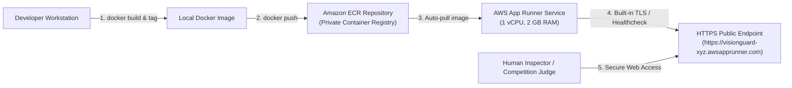

# VisionGuard AI — AWS Cloud Deployment Specification

## 1. Current Deployment Status

| Item | Status | Verification Detail |
| :--- | :--- | :--- |
| **Local Dockerfile** | **READY** | Validated multi-stage container spec (`Dockerfile`) |
| **AWS CLI & Tools** | **BLOCKED** | AWS CLI is not installed / not on system PATH in this environment |
| **AWS Account Credentials** | **NOT CONFIGURED** | No AWS API credentials provided in environment |
| **Live Cloud Deployment** | **NOT DEPLOYED** | Cloud resource creation withheld per Rule 6 (no cost authorization) |

> [!WARNING]
> In strict accordance with competition integrity rules, local Docker container execution is NOT represented as an active AWS deployment. Live deployment remains **BLOCKED / NOT RUN** pending user cloud credentials and explicit cost approval.

---

## 2. Recommended AWS Target Architecture: AWS App Runner

For the OpenCV AI Competition 2026, **AWS App Runner** represents the optimal, minimal, cost-conscious architecture for deploying VisionGuard AI:
- **Fully Managed Container Platform**: Directly runs our Docker container from Amazon ECR without cluster or VPC management overhead.
- **Integrated TLS & Ingress**: Automatic HTTPS endpoints with health checking.
- **Predictable Cost**: Billed on active vCPU and memory; approximately \$0.007/GB-hour (~\$5 to \$15/month when paused after demonstration).
- **Automated Health Monitoring**: Built-in HTTP health check pointing to Streamlit's native health probe (`/_stcore/health`).



---

## 3. Step-by-Step Deployment Instructions

When you are ready to deploy to AWS, execute the following commands using the AWS CLI and Docker:

### Step 1: Configure AWS CLI & Verify Identity
```bash
aws configure
# Verify active identity without exposing keys:
aws sts get-caller-identity
```

### Step 2: Create Amazon ECR Private Repository
```bash
export AWS_REGION=us-east-1
export AWS_ACCOUNT_ID=$(aws sts get-caller-identity --query Account --output text)
export REPO_NAME=visionguard-ai

aws ecr create-repository \
    --repository-name $REPO_NAME \
    --region $AWS_REGION \
    --image-scanning-configuration scanOnPush=true
```

### Step 3: Authenticate Docker to Amazon ECR
```bash
aws ecr get-login-password --region $AWS_REGION | \
    docker login --username AWS --password-stdin $AWS_ACCOUNT_ID.dkr.ecr.$AWS_REGION.amazonaws.com
```

### Step 4: Build and Push the VisionGuard AI Container
```bash
# Build the container locally
docker build -t visionguard-ai:latest .

# Tag for Amazon ECR
docker tag visionguard-ai:latest $AWS_ACCOUNT_ID.dkr.ecr.$AWS_REGION.amazonaws.com/$REPO_NAME:latest

# Push to Amazon ECR
docker push $AWS_ACCOUNT_ID.dkr.ecr.$AWS_REGION.amazonaws.com/$REPO_NAME:latest
```

### Step 5: Deploy AWS App Runner Service
Create an App Runner service configuration with health check:

```bash
aws apprunner create-service \
    --service-name visionguard-inspection-service \
    --source-configuration '{
        "ImageRepository": {
            "ImageIdentifier": "'$AWS_ACCOUNT_ID'.dkr.ecr.'$AWS_REGION'.amazonaws.com/'$REPO_NAME':latest",
            "ImageConfiguration": {
                "Port": "8501",
                "RuntimeEnvironmentVariables": {
                    "STREAMLIT_SERVER_HEADLESS": "true"
                }
            },
            "ImageRepositoryType": "ECR"
        },
        "AutoDeploymentsEnabled": false
    }' \
    --instance-configuration '{
        "Cpu": "1 vCPU",
        "Memory": "2 GB"
    }' \
    --health-check-configuration '{
        "Protocol": "HTTP",
        "Path": "/_stcore/health",
        "Interval": 10,
        "Timeout": 5,
        "HealthyThreshold": 1,
        "UnhealthyThreshold": 3
    }'
```

---

## 4. Resource Teardown (Prevent Cloud Billing)

Immediately following the demonstration or evaluation, eliminate all cloud resources to ensure zero ongoing charges:

```bash
# 1. Delete App Runner Service
aws apprunner delete-service --service-arn <SERVICE_ARN>

# 2. Delete ECR Repository and Images
aws ecr delete-repository --repository-name visionguard-ai --force
```

